# Multi-Agent Advertisement System

▶ [Open the web user interface](https://adops-console.vercel.app/)

Note: This interface is for display purposes only. It does not function because the project currently has no credits.

An n8n-based, human-guided system for taking an advertising brief from intake
through research, creative development, copywriting, storyboarding, and
AI-assisted media production. A lightweight web console provides the client
conversation, approval points, and project status. Supabase stores workflow
state and production assets.

> **Important:** The JSON files in `workflow/` are workflow exports, not a
> one-click hosted service. Import them into your n8n instance, configure
> credentials and database resources, and test with non-production services
> before using them for live campaigns.

## At a glance

## Workflow

▶ [Open the interactive version](https://htmlpreview.github.io/?https://github.com/YourGuyD3v/multi-agent-advertisement-system/blob/main/docs/animated-flow.html)

The workflow is stateful: incoming messages are appended to the project record
and routed according to its current state. Creative work is presented for
client feedback before the storyboard is handed to the production workflow.
Production can take longer than a webhook request, so the console supports
progress updates through `/api/update` and `/api/status`.

## What it does

- **Intake and state management:** receives webhook messages, creates or loads
  a project row, records the conversation, and routes work based on project
  state.
- **Ad validation:** discusses the proposed idea with the client, then saves
  the confirmed direction and starts research.
- **Research:** uses an AI research agent and connected research tool to answer
  open questions; errors can be reported back to the console.
- **Creative direction:** develops a strategy, requests client input when
  needed, and allows an additional research loop before drafting.
- **Copy and storyboard:** iterates on copy with the client, stores drafts,
  then generates and approves the storyboard.
- **Media production:** plans scene-level assets and creates images, image-based
  video, music, sound effects, voice, and an edited render through connected
  providers.
- **Console integration:** a static Vercel-hosted UI calls server-side API
  routes, keeping n8n endpoints and credentials out of browser requests.

## Screenshots: complete workflow

These screenshots document the workflow from its top-level orchestration
through production and completion. They are in chronological walkthrough
order; the two copy screenshots show the same workflow at different framing.

### Orchestration and intake

*Top-level system and routing from user input through production.*

*The production sub-workflow coordinates planning, media generation, editing,
and response handling.*

*The main workflow starts from a POST webhook.*

*Project state is loaded or created, updated, and routed to the appropriate
stage.*

*The validator converses with the client until the idea is confirmed.*

*The research agent uses memory and a connected research tool, saves findings,
and reports errors.*

*The creative agent may request client input or another research loop before
continuing.*

### Copy, storyboard, and production handoff

*Copy is drafted, saved, and returned to the client for review.*

*The storyboard stage turns the approved creative concept and ad copy into a scene-by-scene visual blueprint, mapping each moment to camera direction, action, messaging, and production requirements before handoff.*

*The approved storyboard is passed to the separate Production Agent workflow.*

*Project-stage updates are sent to the console.*

*The production workflow accepts calls from the orchestration workflow.*

*The planner turns the approved storyboard into structured production
instructions.*

### Media generation and final render

*Image jobs are submitted, polled until complete, and saved to the production
record.*

*Video clips are generated from the planned visual assets and polled for
completion.*

*The music stage creates and stores a soundtrack.*

*Sound effects are generated, reviewed/edited where needed, and collected.*

*Voice segments are generated and collected for the edit.*

*The editing stage assembles the timeline, checks render status, retries, and
handles failures.*

*The completed state is reported back after the response is sent.*

## Repository layout

| Path | Purpose |
|---|---|
| `workflow/Multi-Agent-Ads-System.json` | Main webhook-driven orchestration workflow |
| `workflow/Sub-Workflow-Production-Agent.json` | Production planning, asset generation, and editing sub-workflow |
| `adops-console/` | Static client console and Vercel serverless API routes |
| `docs/architecture.md` | Components, lifecycle, and workflow boundaries |
| `docs/data-model.md` | Project state, production data, and callback payload shapes |
| `docs/setup.md` | Import, provider credentials, deployment, and configuration |
| `docs/testing.md` | Import checks, smoke tests, and failure scenarios |
| `docs/design-decisions.md` | Human approval gates and implementation rationale |
| `docs/limitations.md` | Known operational constraints and risks |
| `assets/screenshots/` | Screenshots shown in this README |
| `demo/demo-link.md` | Demo and walkthrough reference |

## Quick start

1. Read [the setup guide](docs/setup.md) and confirm you have n8n, Supabase,
   the required model/provider accounts, and a Vercel project if using the
   console.
2. Import both JSON exports into n8n and reconnect credentials/resources.
3. Create and verify the Supabase tables and fields used by the workflows.
4. Configure and activate the main webhook workflow; copy its production URL.
5. Configure the console environment variables in Vercel and deploy
   `adops-console/`.
6. Run the [smoke tests](docs/testing.md) with a test project and verify both
   the database state and console responses before live use.

## Documentation

- [Architecture](docs/architecture.md)
- [Data model and payloads](docs/data-model.md)
- [Setup and deployment](docs/setup.md)
- [Testing and operations](docs/testing.md)
- [Design decisions](docs/design-decisions.md)
- [Limitations](docs/limitations.md)
- [Ad Production Console API](adops-console/README.md)

## Security notes

- Do not commit `.env`, `.env.local`, Vercel project metadata, API keys, or
  provider credentials.
- Configure secrets in the Vercel and n8n secret stores, not in workflow
  expressions or browser code.
- Protect public webhook endpoints with authentication or an equivalent
  gateway policy appropriate to your deployment.
- Use a callback token for n8n-to-console progress updates and a console token
  for browser-to-API calls when the console is publicly accessible.

See [setup](docs/setup.md) and [limitations](docs/limitations.md) for
configuration caveats and known design boundaries.

Made with Love ❤️
